<p align="center">
  
</p>

<h1 align="center">REST — URL Detection with Machine Learning (FNN)</h1>

<p align="center">
  An Android app that checks links and QR codes for phishing <b>before</b> you open them.<br>
  On-device neural network + Google Safe Browsing, with a redesigned "autumn arcade" interface.
</p>

<p align="center">
  
  
  
  
  
</p>

---

## What's new in v2

Version 1 (on the `main` branch) was a working prototype: type or scan a URL and get *Safe* / *Phishing* from an on-device FNN.
Version 2 keeps the same model and rebuilds everything around it.

| | v1 | v2 (this branch) |
|---|---|---|
| **Interface** | Basic Compose screens | Full redesign ("REST"), designed with **Claude Design** and implemented with **Claude Code** |
| **Verdict** | Safe / Phishing | **Safe / Suspicious / Dangerous**, with a confidence bar |
| **Detection** | Static only (on-device model) | Static (on-device model) **+ dynamic** (Google Safe Browsing) |
| **Explanation** | — | *Why this result* card (HTTPS, IP address, subdomains, URL randomness, Safe Browsing match) |
| **History** | — | Recent checks on Home and a full history screen, stored on the device (Room) |
| **Opening links** | Open directly | Suspicious and Dangerous links only open after a confirmation dialog |
| **Theme** | Light | Light, dark, or follow the system |

## Screens

Each image shows the screen in light and dark mode.

| Home | Scan QR code | Analyzing |
|:---:|:---:|:---:|
| 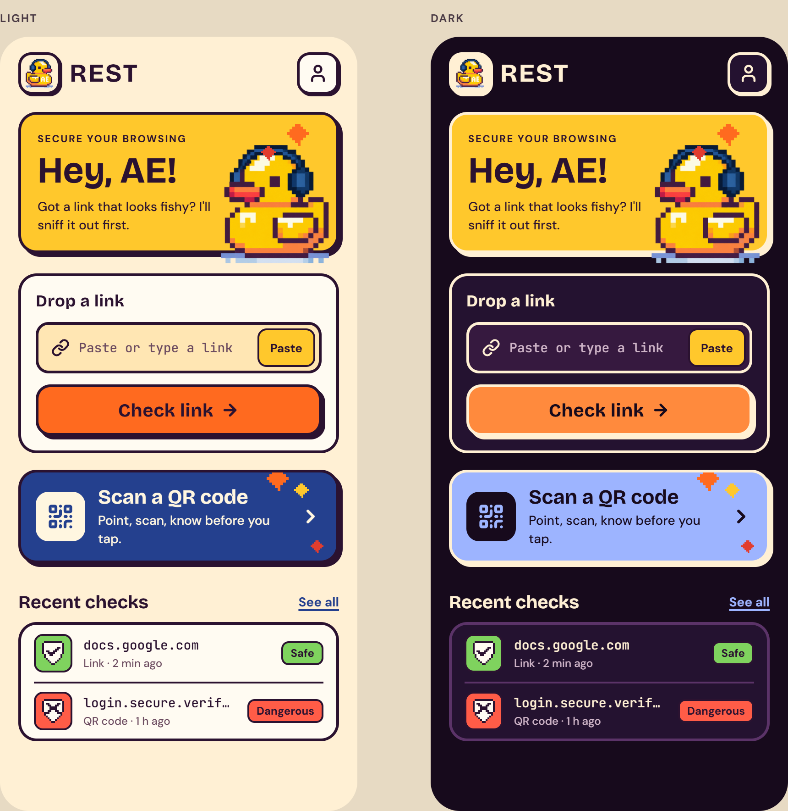 | 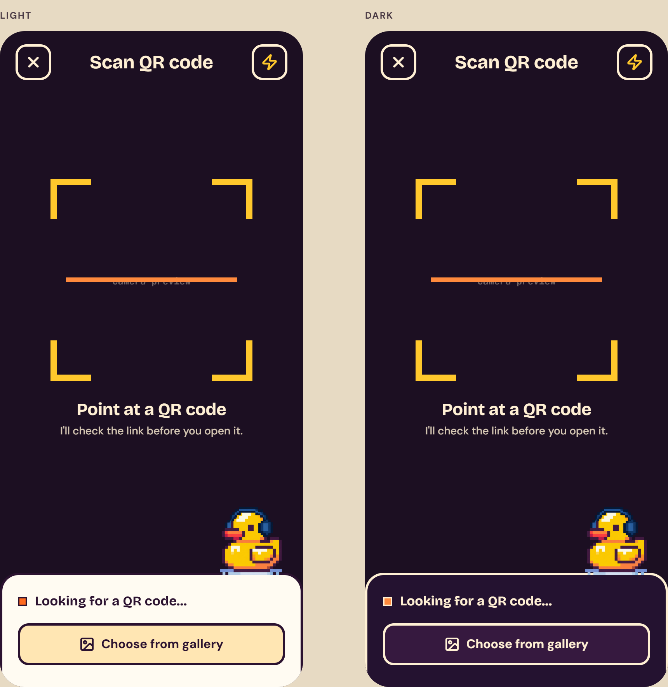 | 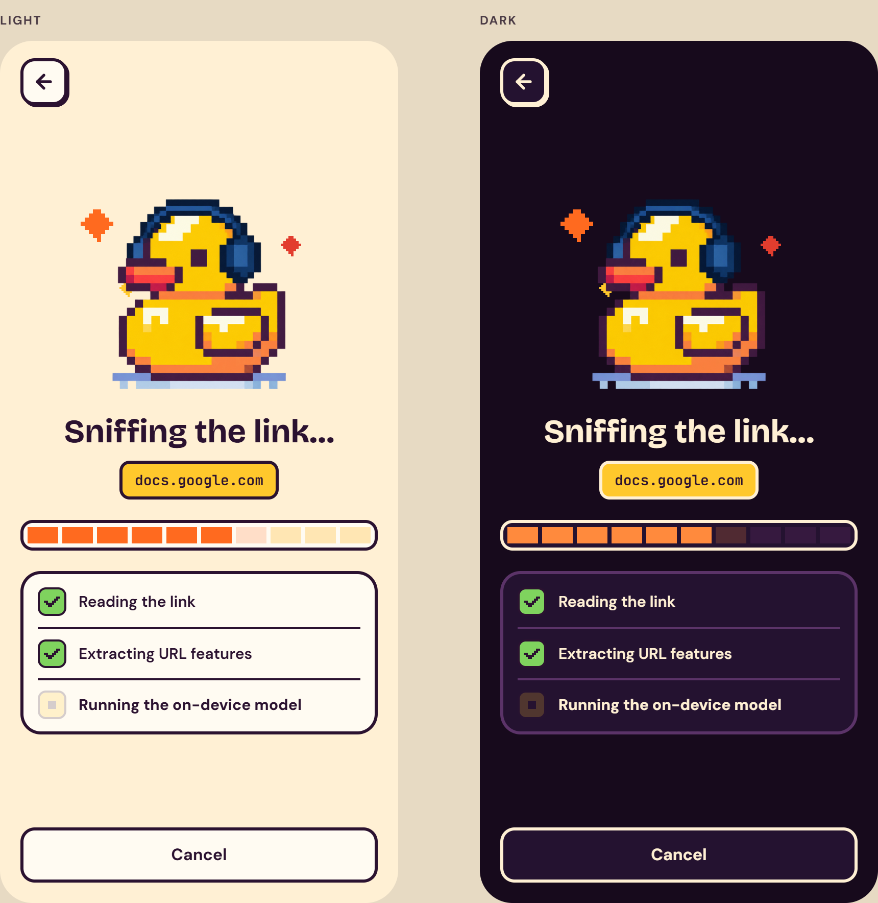 |

| Result: Safe | Result: Suspicious | Result: Dangerous |
|:---:|:---:|:---:|
| 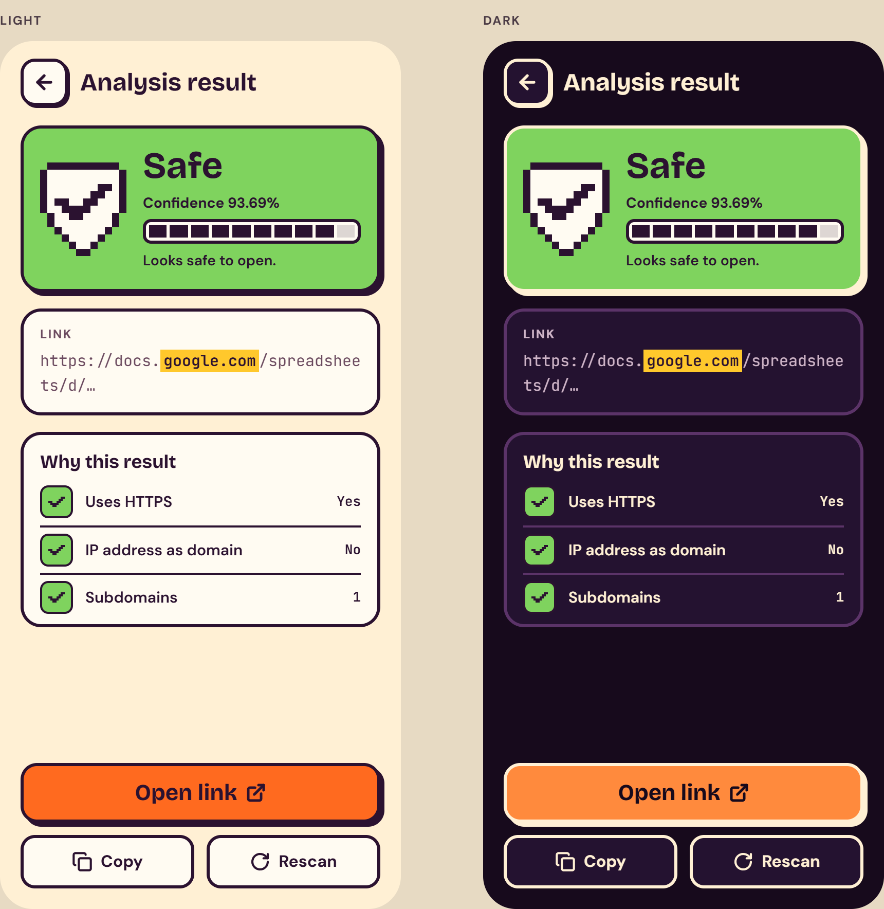 | 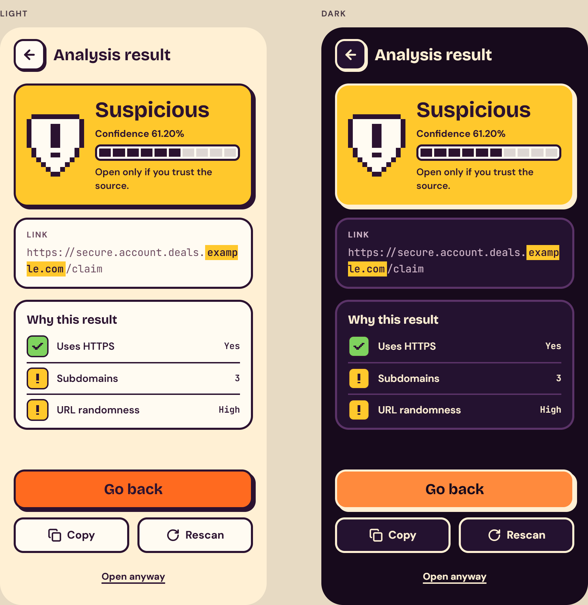 | 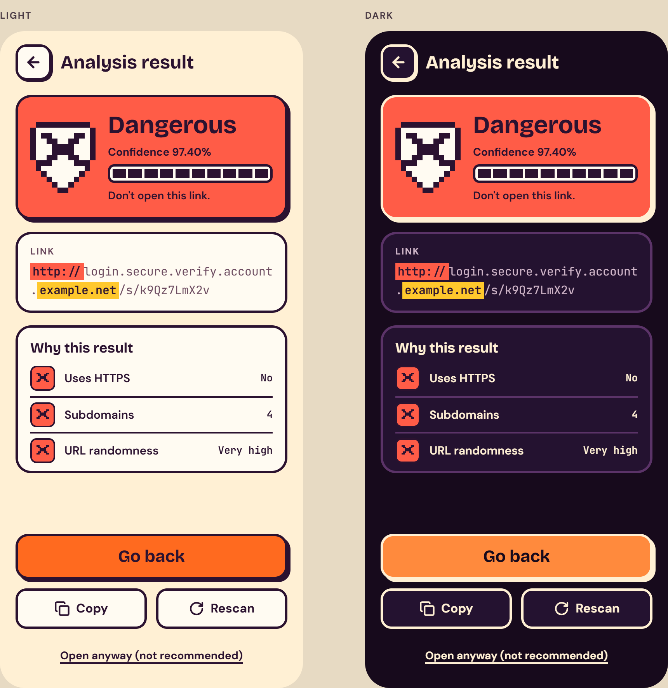 |

| History | Profile and theme |
|:---:|:---:|
| 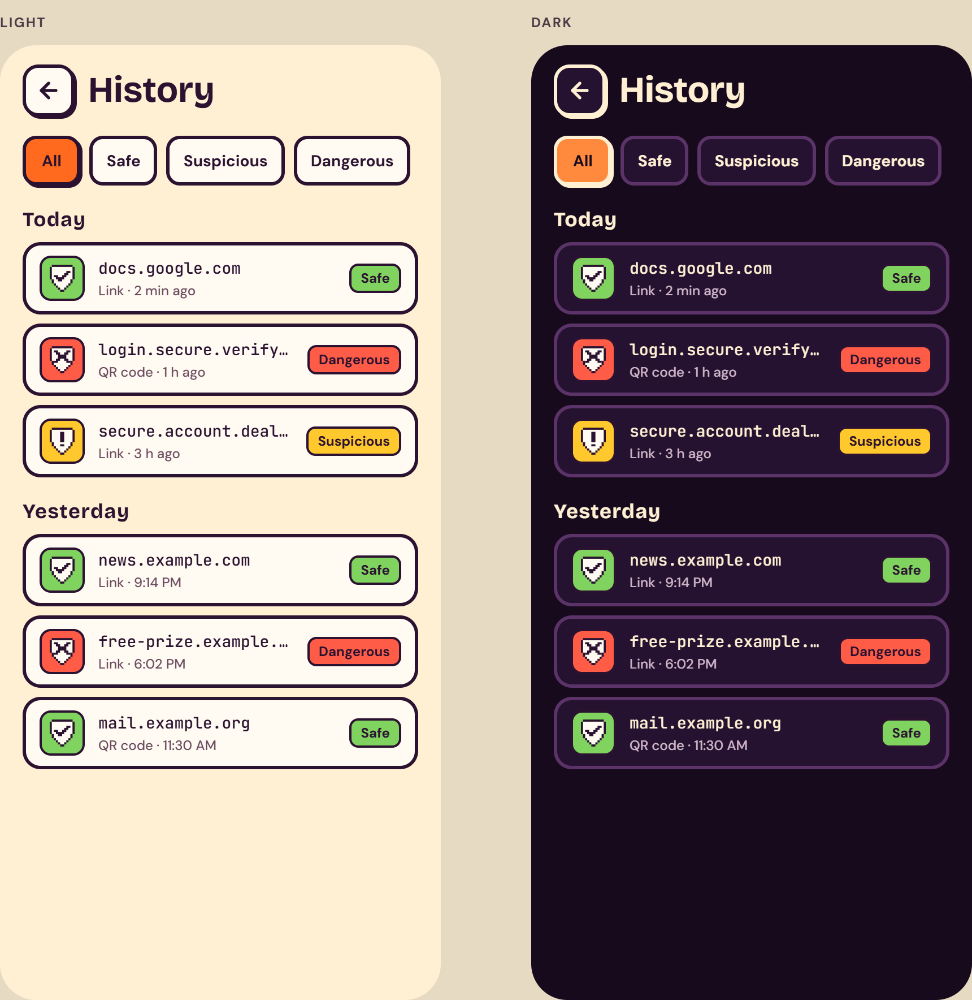 | 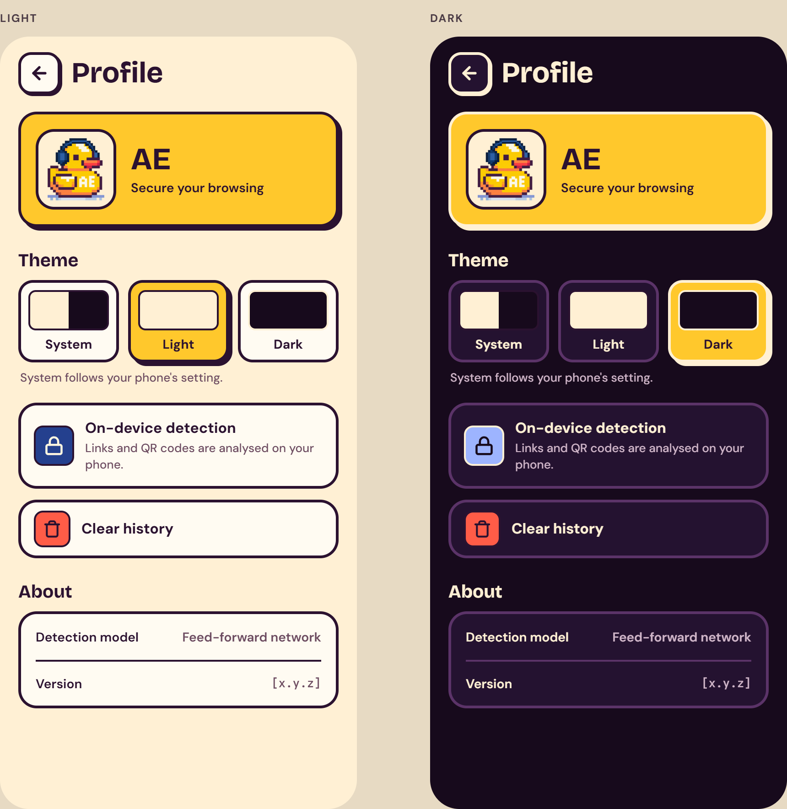 |

<details>
<summary>v1 interface, for comparison</summary>

| Main page | Result page |
|:---:|:---:|
| 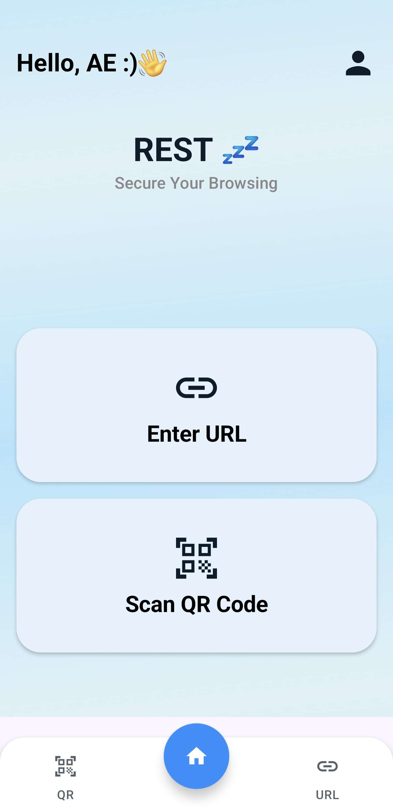 | 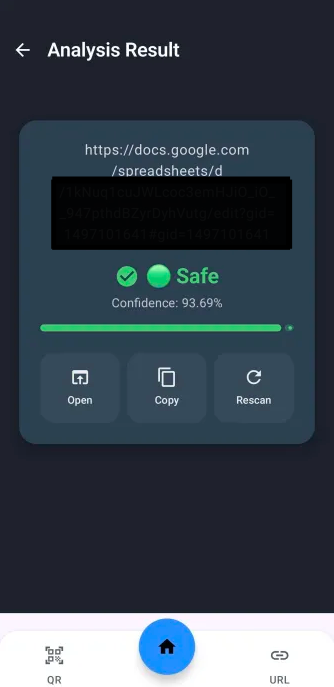 |

</details>

## Features

- **Two ways to check a link:** paste or type a URL, or scan a QR code with the camera (CameraX + ZXing).
- **On-device detection:** a TensorFlow Lite feed-forward neural network scores every link on the phone. It works offline.
- **Google Safe Browsing (dynamic detection):** when the online check is on, the link is also looked up against Google's live lists of malware, phishing, unwanted software and harmful apps.
- **Three-level verdict** with a confidence percentage and a 10-block confidence bar.
- **Link anatomy:** the scheme, subdomains and registrable domain are highlighted, so look-alike domains like `paypal.com.secure-login.example.net` are easy to spot.
- **Why this result:** plain-language signals read from the link.
- **Safe opening:** Suspicious and Dangerous links never open directly. You have to confirm first.
- **History:** every check is saved on the device and can be reopened or cleared from Profile.
- **Light / dark / system theme**, fonts bundled with the app (works offline).

## How a link is checked

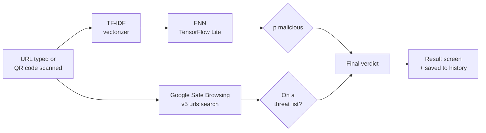

### 1. On-device model (static detection)

The FNN outputs the probability that the link is malicious. It is mapped to a verdict:

| Probability malicious | Verdict |
|---|---|
| below 0.30 | 🟢 **Safe** — looks safe to open |
| 0.30 to 0.70 | 🟡 **Suspicious** — open only if you trust the source |
| 0.70 and above | 🔴 **Dangerous** — don't open this link |

The cut-offs live in [`Verdict.kt`](app/src/main/java/com/example/url_detection/data/Verdict.kt).

### 2. Google Safe Browsing (dynamic detection)

The model only sees the text of the URL. Google Safe Browsing adds live threat intelligence for links that are already known to be bad.

The two are combined with one rule: **Safe Browsing can only make the verdict stricter.**

- A Safe Browsing match → **Dangerous**, whatever the model says.
- No match, no network, or online check turned off → the model's verdict stands. New phishing links often aren't on Google's lists yet, so "no match" never overrides the model.

Details:

- Uses the **v5 `urls:search`** endpoint. It answers in protobuf only, so the app decodes the response itself ([`SafeBrowsing.kt`](app/src/main/java/com/example/url_detection/data/SafeBrowsing.kt)).
- Results are cached in memory and the call has a short timeout. Any error falls back to the on-device verdict, so the app never fails because of the network.
- **Privacy:** with the online check on, the full URL you check is sent to Google. You can turn the online check off in **Profile**. Everything else, including history, stays on the device.

## The model

The detection model is a **Feed-Forward Neural Network (FNN)** built with Keras and converted to TensorFlow Lite for on-device inference.

### Input: TF-IDF on character n-grams

Each URL is turned into a vector with **TF-IDF over character 3- to 5-grams**. The vocabulary has **5,000 n-grams** (`tfidf_data.json`). Character n-grams pick up the small tricks used in phishing URLs, such as `paypa1` instead of `paypal`.

### Architecture

| Layer | Description |
|---|---|
| Input | 5,000 TF-IDF features |
| Dense (64, ReLU) | Learns higher-level URL representations |
| Dense (32, ReLU) | Extracts non-linear patterns |
| Dense (1, Sigmoid) | Output score (the app converts it to the probability of being malicious) |

Trained with binary cross-entropy, the Adam optimizer and early stopping.

### Static URL features

Following the dataset methodology in [DOI: 10.17632/hx4m73v2sf.2](https://doi.org/10.17632/hx4m73v2sf.2), v1 described 16 static URL features (URL length, IP address, dot count, HTTPS, entropy, subdomain count, and others).
In v2, four of them are computed in the app and shown on the *Why this result* card: **HTTPS**, **IP address as domain**, **subdomain count** and **URL randomness** (Shannon entropy).
These are for explanation only. The TF-IDF vector is the model's input.

### Dataset

[Grambeddings Dataset](https://web.cs.hacettepe.edu.tr/~selman/grambeddings-dataset/), a balanced set of benign and phishing URLs.

### Results

**5-fold cross-validation**

| Fold | Best epoch | Val. accuracy | Val. F1 |
|---|---|---|---|
| 1 | 3 | 0.9615 | 0.9620 |
| 2 | 3 | 0.9601 | 0.9603 |
| 3 | 2 | 0.9595 | 0.9600 |
| 4 | 3 | 0.9613 | 0.9616 |
| 5 | 3 | 0.9615 | 0.9620 |
| **Mean** | | **0.9607 ± 0.0008** | **0.9612 ± 0.0009** |

**Final model (trained on the full dataset), best epoch 3:** validation accuracy **0.9622**, F1 ≈ **0.962**, loss **0.1015**.

## Tech stack

| Area | Library |
|---|---|
| Language / UI | Kotlin, Jetpack Compose, Material 3, Navigation Compose |
| ML inference | TensorFlow Lite 2.13 |
| QR scanning | CameraX, ZXing |
| Online check | OkHttp, Google Safe Browsing API v5 |
| Storage | Room (history), DataStore (theme and online-check setting) |
| Design | Claude Design (screens, design tokens, pixel duck), implemented with Claude Code |

## Project structure

```
app/src/main/
├── assets/
│   ├── Keras_NN_Traditional_Dataset_final_mem_safe.tflite   # FNN model
│   └── tfidf_data.json                                      # TF-IDF vocabulary + IDF weights
├── java/com/example/url_detection/
│   ├── MainActivity.kt          # Navigation and check flow
│   ├── UrlPredictor.kt          # TF-IDF + TFLite inference
│   ├── data/
│   │   ├── Verdict.kt           # Thresholds and the final-verdict rule
│   │   ├── SafeBrowsing.kt      # Google Safe Browsing v5 client
│   │   ├── UrlSignals.kt        # Link anatomy and "Why this result" signals
│   │   ├── History.kt           # Room database for past checks
│   │   └── AppSettings.kt       # Theme and online-check preference
│   └── ui/
│       ├── screens/             # Home, QR scanner, Analyzing, Result, History, Profile
│       ├── components/          # Arcade-style buttons, cards, pixel art, icons
│       └── theme/               # REST colors, type and theme
└── res/font/                    # Bricolage Grotesque, DM Sans, JetBrains Mono
```

## Getting started

### Requirements

- Android Studio (recent stable version)
- JDK 11 or newer
- An Android device or emulator running Android 8.0 (API 26) or newer

### 1. Clone and open

```bash
git clone -b v2-rest-redesign https://github.com/Elmeralex/URL-Detection-Applciation---Machine-Learning-FNN-.git
```

Open the folder in Android Studio and let Gradle sync.

### 2. Add a Google Safe Browsing API key (optional)

The app works without a key. Only the on-device model is used, and the Safe Browsing row shows *Unreachable*.

To turn on the online check:

1. In [Google Cloud Console](https://console.cloud.google.com/), create a project and enable the **Safe Browsing API**.
2. Create an API key. Restrict it to the **Safe Browsing API** and to the Android app `com.example.url_detection` with your signing certificate's SHA-1. The app sends `X-Android-Package` and `X-Android-Cert` headers so the restriction works.
3. Add the key to `local.properties` in the project root. This file is git-ignored, so don't commit it.

```properties
SAFE_BROWSING_API_KEY=your_api_key_here
```

The key is read into `BuildConfig.SAFE_BROWSING_API_KEY` at build time.

> Google Safe Browsing is free for non-commercial use. Commercial apps should use Google's Web Risk API instead.

### 3. Run

Press **Run** in Android Studio, or from the command line:

```bash
./gradlew installDebug
```

### Tests

```bash
./gradlew test
```

Unit tests cover the Safe Browsing protobuf decoding and the stricter-only verdict rule.

## Limitations

- The model looks at the URL text only. It does not visit the page, so a clean-looking URL hosting phishing content can still score as Safe. Google Safe Browsing covers part of that gap for known threats.
- Safe Browsing only knows about threats Google has already listed, so brand-new phishing links depend on the model.
- The Suspicious/Dangerous thresholds (0.30 / 0.70) are starting values and can be tuned against the validation set.

## Acknowledgements

- Dataset: [Grambeddings](https://web.cs.hacettepe.edu.tr/~selman/grambeddings-dataset/), Hacettepe University
- Feature methodology: [Mendeley Data, DOI 10.17632/hx4m73v2sf.2](https://doi.org/10.17632/hx4m73v2sf.2)
- Threat intelligence: [Google Safe Browsing](https://developers.google.com/safe-browsing)
- UI design: made with Claude Design; implementation and Safe Browsing integration with Claude Code

## License

[MIT](LICENSE)
